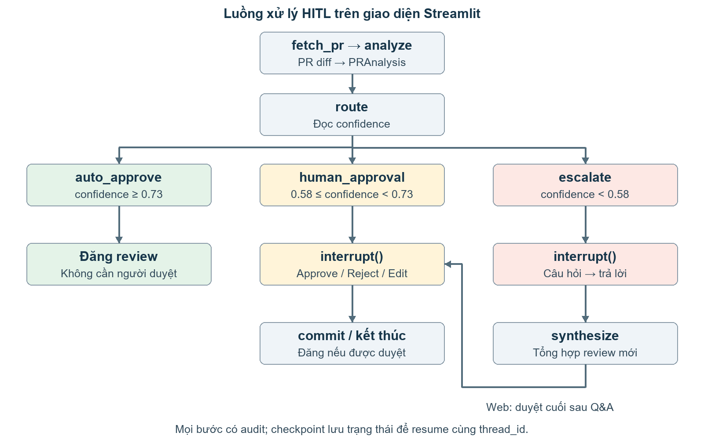
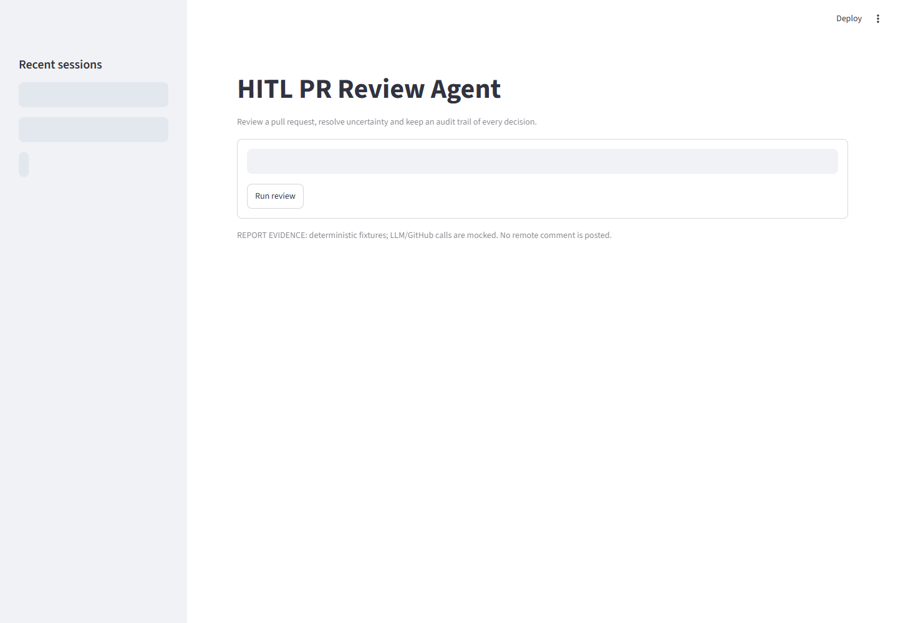
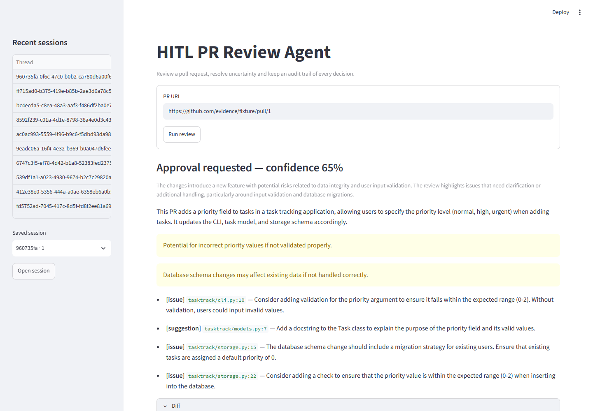
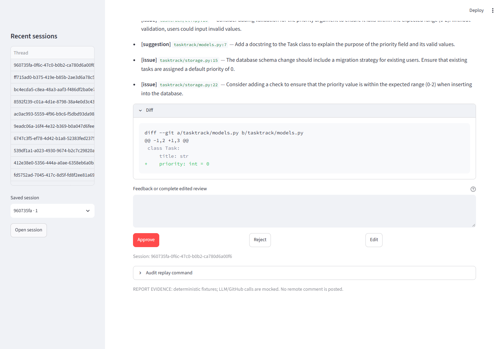
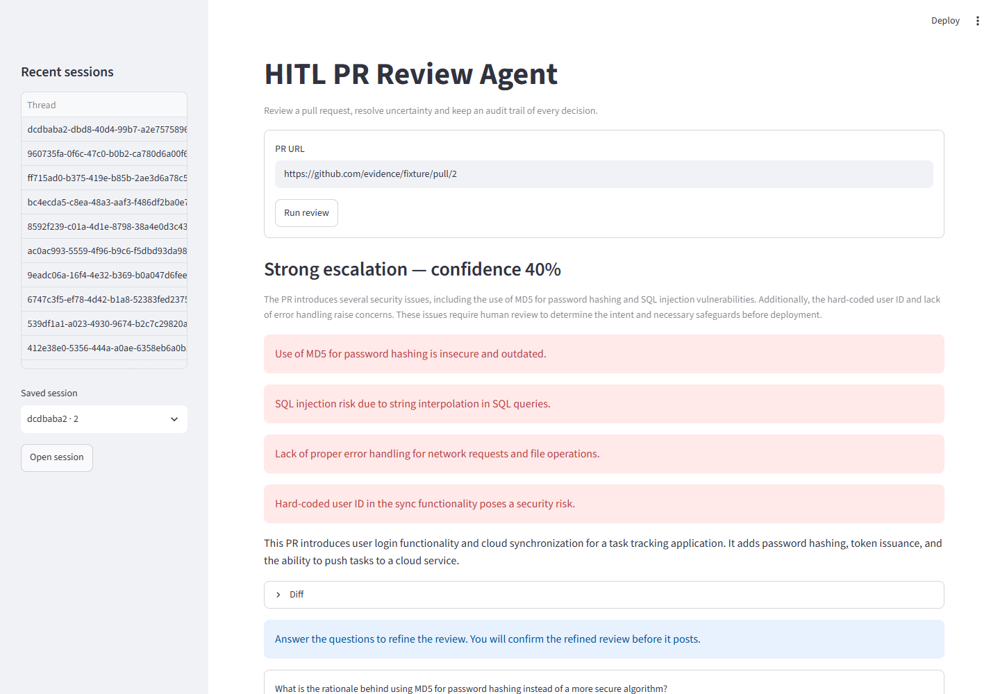
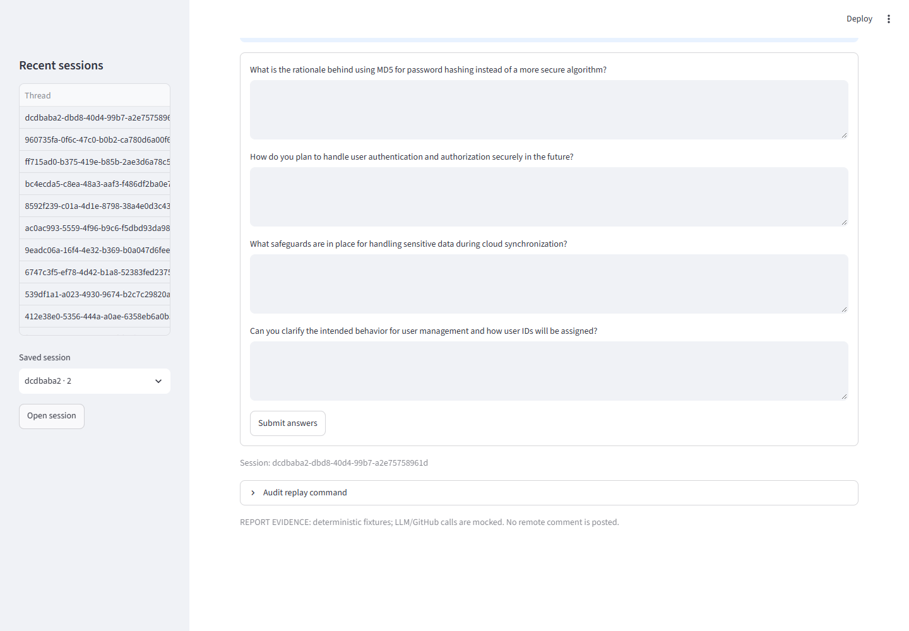
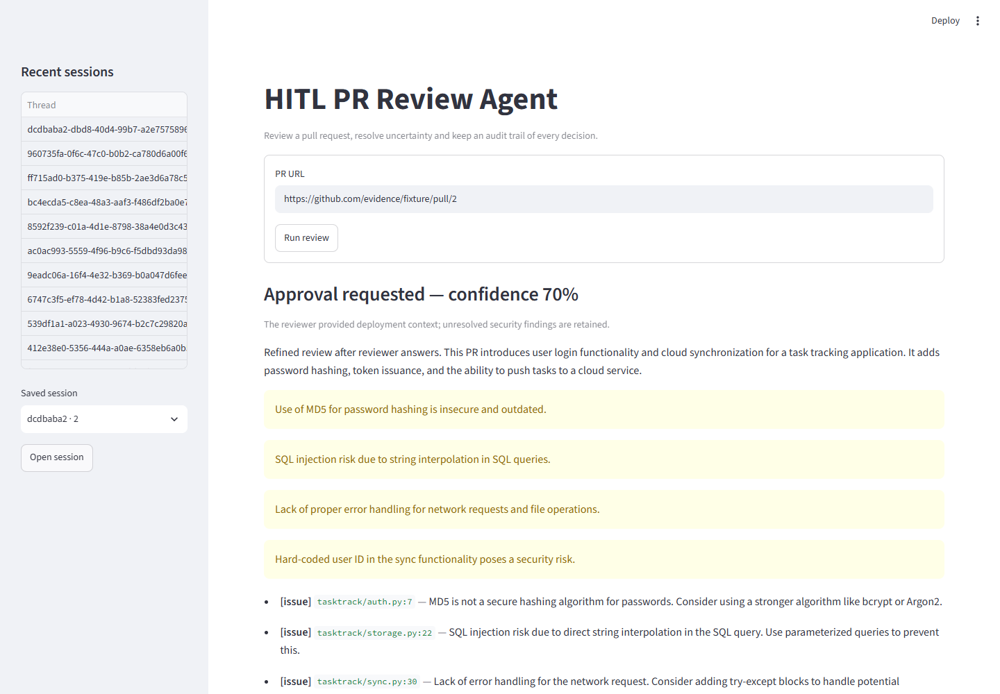
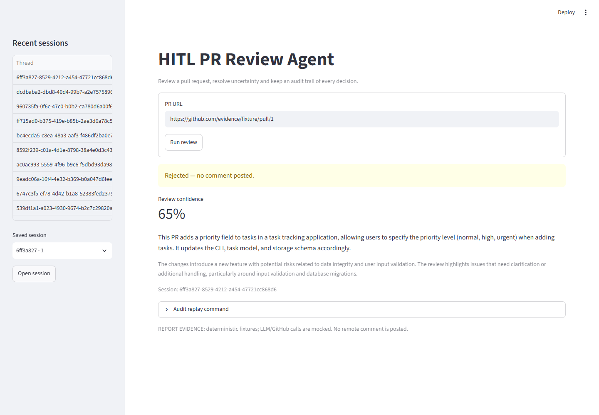
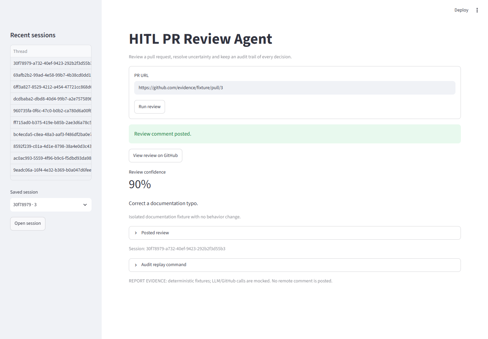

# BÁO CÁO THỰC HÀNH — DAY27 TRACK 3

**Đề tài: HITL PR Review Agent — Agent review pull request có con người tham gia**

| Thông tin | Nội dung |
| --- | --- |
| Họ và tên | Mai Quang Dũng |
| Mã học viên | 2A202602966 |
| Khóa | K4 |
| Bài thực hành | LAB12 — Day27, Track03 |
| Ngày hoàn thành | 15/10/2026 |
| Repository bài nộp | https://github.com/DungMQ/K4-DAY27-MaiQuangDung-2A202602966 |

Bản nộp có [PDF](submission/Bao_cao_DAY27_MaiQuangDung_2A202602966.pdf),
[Word](submission/Bao_cao_DAY27_MaiQuangDung_2A202602966.docx) và Markdown này.
Mã nguồn, ảnh giao diện, log kiểm thử và dữ liệu audit nằm trong cùng repository.
Bộ nộp gộp tại [K4-DAY27-MaiQuangDung-2A202602966.zip](submission/K4-DAY27-MaiQuangDung-2A202602966.zip).

## Mục lục

- 1. Mục tiêu và phạm vi bài thực hành
- 2. Cơ sở lý thuyết và thiết kế hệ thống
- 3. Môi trường và hướng dẫn tái lập
- 4. Triển khai năm bài tập
- 5. Kết quả chạy với GitHub và OpenAI thật
- 6. Minh chứng giao diện trên trình duyệt
- 7. Audit trail, truy vấn SQL và replay
- 8. Kiểm thử và đối chiếu yêu cầu
- 9. Giới hạn, bảo mật và hướng phát triển
- 10. Kết luận
- 11. Danh mục tệp nộp và tài liệu tham khảo

## 1. Mục tiêu và phạm vi bài thực hành

Bài lab xây dựng một agent đọc thay đổi của pull request, phân tích mã, đề xuất
review và điều phối sự tham gia của reviewer theo độ tin cậy của kết quả.
Các mục tiêu chính là sử dụng LangGraph `interrupt()`, tiếp tục phiên bằng
`Command(resume=...)`, cung cấp giao diện Streamlit và lưu được lịch sử quyết định.

Đầu vào là URL pull request trên GitHub. Đầu ra gồm `PRAnalysis`, nhánh xử lý,
quyết định của reviewer, kết quả đăng hoặc từ chối review, checkpoint và audit trail.
Thao tác được scaffold gọi là “commit review” thực chất đăng bình luận thảo luận
lên PR qua GitHub Issues API; không commit thay đổi mã hay merge PR.

Phạm vi hoàn thành là **5 bài bắt buộc trong README**. Các bonus về time-travel,
hiệu chỉnh confidence trên dữ liệu thực, multi-reviewer fan-out và tự viết lại bằng
LLM khi Edit chưa được triển khai như tính năng riêng. Edit hiện nhận trực tiếp
nội dung thay thế do người duyệt nhập.

README có dòng deliverable “PostgreSQL audit trail”, đồng thời nêu rõ scaffold
cho phép dùng **SQLite để không cần cài PostgreSQL**. Bài làm tuân theo phiên bản
SQLite này, không tuyên bố đã triển khai PostgreSQL. Các module trong `common`
được giữ nguyên theo hướng dẫn bài lab.

## 2. Cơ sở lý thuyết và thiết kế hệ thống

### 2.1. Human-in-the-loop và confidence

HITL đưa con người vào những bước cần bổ sung ngữ cảnh hoặc kiểm soát quyết định.
Agent xử lý các bước thu thập, phân tích và tổng hợp; reviewer kiểm tra diff,
phản hồi hoặc trả lời các câu hỏi cụ thể mà mô hình chưa giải quyết được.

`PRAnalysis` là schema Pydantic gồm `summary`, `risk_factors`, `comments`,
`confidence`, `confidence_reasoning` và `escalation_questions`. Mỗi comment có
đường dẫn tệp, dòng nếu biết, mức độ và nội dung. Đầu ra có cấu trúc giúp graph
định tuyến và UI hiển thị dữ liệu mà không cần tách chuỗi văn bản tự do.

Confidence là số mô hình tự báo cáo trong khoảng 0–1; nó **không phải xác suất
đúng đã được kiểm chứng**. Prompt yêu cầu đánh giá tính đầy đủ, độ an toàn và
ngữ cảnh còn thiếu, đặc biệt với xác thực, lưu credential, SQL injection hoặc cloud sync.

| Điều kiện chính xác trong mã | Nhánh | Vai trò reviewer |
| --- | --- | --- |
| `confidence >= 0.73` | `auto_approve` | Agent đăng review trực tiếp. |
| `0.58 <= confidence < 0.73` | `human_approval` | Đọc diff, reasoning và chọn Approve/Reject/Edit. |
| `confidence < 0.58` | `escalate` | Trả lời câu hỏi; web yêu cầu duyệt review đã tổng hợp. |

Các hằng số nằm trong `common/schemas.py`. Giá trị đúng bằng **0.58** thuộc
nhánh duyệt thủ công; đúng bằng **0.73** thuộc nhánh tự động. Bài làm dùng hằng số
gốc, không thay đổi ngưỡng để ép PR mẫu vào nhánh mong muốn.

### 2.2. Graph, interrupt và checkpoint

LangGraph tổ chức luồng thành các node đọc/cập nhật `ReviewState`. `interrupt(payload)`
tạm dừng và cung cấp dữ liệu cho bên gọi. Khi nhận phản hồi, graph được gọi lại
với cùng `thread_id` và `Command(resume=answer)`. Node chứa interrupt được chạy lại
từ đầu khi resume, nên tác dụng phụ phải được bố trí cẩn thận [1].

Bài 2–3 dùng `MemorySaver` trong cùng tiến trình. Bài 4–5 dùng `AsyncSqliteSaver`
để checkpoint tồn tại qua lần mở kết nối hoặc khởi động lại. Các lớp Pydantic
được cho phép rõ ràng trong serializer khi nạp lại checkpoint.



Hình 1. Luồng trên web: sau escalation, review đã tổng hợp vẫn phải được reviewer
xác nhận. Nhánh tự động đăng tại node `auto_approve`; nhánh có người duyệt hội tụ
về `commit`.

### 2.3. Phân chia trách nhiệm

| Thành phần | Trách nhiệm |
| --- | --- |
| `common/github.py` | Lấy metadata, diff, tệp thay đổi; đăng bình luận qua REST API. |
| `common/llm.py` | Khởi tạo `ChatOpenAI` với model, base URL và khóa từ môi trường. |
| `common/schemas.py` | Định nghĩa state, schema phân tích, audit và ngưỡng phân luồng. |
| `exercises/exercise_1_confidence.py` | Phân tích có cấu trúc và định tuyến cơ bản. |
| `exercises/exercise_2_hitl.py` | Payload duyệt, kiểm tra lựa chọn, interrupt và resume. |
| `exercises/exercise_3_escalation.py` | Câu hỏi, kiểm tra câu trả lời và tổng hợp review mới. |
| `exercises/exercise_4_audit.py` | Graph bền vững, ghi audit, khôi phục phiên. |
| `app.py` | Giao diện Streamlit cho reviewer. |
| `audit/schema.sql`, `audit/replay.py` | Schema audit, danh sách phiên và timeline replay. |

Thiết kế sử dụng lại payload duyệt, prompt và hàm tổng hợp giữa các bài. Phần ghi
sự kiện chờ nằm ở node trước interrupt để tránh lặp do resume. Không cache kết nối
SQLite qua nhiều event loop của Streamlit; mỗi lần gọi graph mở và đóng kết nối riêng.

## 3. Môi trường và hướng dẫn tái lập

### 3.1. Môi trường đã kiểm chứng

| Thành phần | Phiên bản |
| --- | --- |
| Python | 3.11.9 |
| LangGraph | 1.2.0 |
| langgraph-checkpoint-sqlite | 3.1.2 |
| langchain-openai | 1.2.1 |
| Streamlit | 1.66.0 |
| Pydantic | 2.13.4 |
| aiosqlite | 0.22.1 |
| Trình duyệt minh chứng | Chrome 155.0.8059.40, headless, profile kiểm thử riêng |

Số liệu phiên bản được ghi tự động trong `artifacts/test_summary.json`.
Dependencies ứng dụng được khóa bằng `uv.lock`; công cụ tạo báo cáo nằm trong
nhóm tùy chọn `report`, không bắt buộc khi chỉ chạy ứng dụng.

### 3.2. Cài đặt và cấu hình

```powershell
git clone https://github.com/DungMQ/K4-DAY27-MaiQuangDung-2A202602966.git
cd K4-DAY27-MaiQuangDung-2A202602966
$env:UV_PROJECT_ENVIRONMENT = "env"
uv sync --locked
Copy-Item .env.example .env
```

Điền khóa thật vào `.env` trên máy cá nhân. Với OpenAI trực tiếp, dùng cấu hình
dưới đây; các giá trị trong báo cáo chỉ là placeholder:

```dotenv
OPENROUTER_API_KEY=<your-openai-api-key>
LLM_MODEL=gpt-4o-mini
LLM_BASE_URL=https://api.openai.com/v1
GITHUB_TOKEN=<your-github-token>
GITHUB_USER=<your-github-username>
```

Biến khóa vẫn tên `OPENROUTER_API_KEY` vì scaffold đọc tên này cho provider
OpenAI-compatible. Không cần sửa `common/llm.py`. `GITHUB_USER` là thông tin cấu
hình được ghi vào audit, không phải cơ chế xác thực nhiều người dùng.

Chạy web bằng Python của môi trường `env`, không cần activate PowerShell:

```powershell
.\env\Scripts\python.exe -X utf8 -m streamlit run app.py
```

Mở `http://localhost:8501`. `-X utf8` giúp hiển thị tiếng Việt và ký tự Rich trên
terminal Windows. SQLite mặc định ở `hitl_audit.db`; có thể đổi bằng `HITL_DB_PATH`.

### 3.3. Chạy từng bài và kiểm thử

```powershell
.\env\Scripts\python.exe -X utf8 exercises/exercise_1_confidence.py --pr https://github.com/VinUni-AI20k/PR-Demo/pull/1
.\env\Scripts\python.exe -X utf8 exercises/exercise_2_hitl.py --pr https://github.com/VinUni-AI20k/PR-Demo/pull/1
.\env\Scripts\python.exe -X utf8 exercises/exercise_3_escalation.py --pr https://github.com/VinUni-AI20k/PR-Demo/pull/2
.\env\Scripts\python.exe -X utf8 exercises/exercise_4_audit.py --pr https://github.com/VinUni-AI20k/PR-Demo/pull/1
.\env\Scripts\python.exe -X utf8 -m unittest discover -s tests -v
.\env\Scripts\python.exe -X utf8 -m scripts.verify_connections
```

Các URL `VinUni-AI20k/PR-Demo` là **PR mẫu để đọc/phân tích theo README**.
Repository nhận mã bài nộp là `DungMQ/K4-DAY27-MaiQuangDung-2A202602966`.
Quá trình tạo minh chứng không tạo PR mới và không đăng bình luận thật.

## 4. Triển khai năm bài tập

### 4.1. Bài 1 — Phân tích và định tuyến

`node_analyze` gọi `get_llm().with_structured_output(PRAnalysis)` với tiêu đề và
diff. Prompt yêu cầu review tính đúng đắn, bảo mật, kiểm thử, tương thích và migration;
nội dung PR được coi là dữ liệu không tin cậy. `node_route` chỉ dùng confidence
và các hằng số ngưỡng để trả `decision`.

Graph nối `START → fetch_pr → analyze → route`, sau đó dùng conditional edges
đến ba node kết thúc. Các node kết thúc của riêng bài 1 chỉ hiển thị nhánh;
đây là phạm vi mà đề bài 1 yêu cầu, chưa đăng bình luận.

### 4.2. Bài 2 — Duyệt thủ công

Payload `approval_request` chứa URL PR, confidence, reasoning, summary,
risk factors, danh sách comment và diff. Graph compile với `MemorySaver` và
CLI lặp cho tới khi không còn interrupt.

```python
while result.get("__interrupt__"):
    payload = result["__interrupt__"][0].value
    result = app.invoke(Command(resume=prompt_human(payload)), cfg)
```

Approve đăng review đề xuất; Reject kết thúc mà không đăng; Edit yêu cầu nội dung
review thay thế không được trống và đăng nội dung đó. Kiểm tra lựa chọn được thực
hiện trước khi node downstream gọi GitHub. Mọi lần resume dùng cùng thread.

### 4.3. Bài 3 — Escalation và Q&A

Khi confidence dưới 0.58, prompt yêu cầu 2–4 câu hỏi cụ thể gắn với tệp hoặc
phần thay đổi. `node_escalate` trả payload `kind="escalation"`; nếu LLM không
tạo câu hỏi, graph có câu hỏi dự phòng. Phản hồi phải trả lời đủ các câu hỏi.

`node_synthesize` đưa diff, phân tích gốc và toàn bộ Q&A vào lần gọi LLM mới.
Prompt yêu cầu giữ lại các vấn đề chưa giải quyết và chỉ tăng confidence khi
câu trả lời thực sự làm rõ ngữ cảnh. Không gán cứng confidence cao hơn.

Trong CLI bài 3–4, nhánh này đăng review tổng hợp sau Q&A theo đề bài tương ứng.
Trên web bài 5, graph dùng `confirm_after_escalation=True` để yêu cầu duyệt cuối.

### 4.4. Bài 4 — Audit và khôi phục phiên

Hàm `audit` gọi `write_audit_event` với context `thread_id`, `pr_url` và
`AuditEntry`. Các bước fetch, analyze, route, chờ/nhận phản hồi, synthesize và
commit đều được lưu. `time.monotonic()` đo thời gian thực thi của từng node;
không dùng timestamp UTC để tính duration.

Các node `request_approval` và `request_escalation` ghi sự kiện chờ trước node
interrupt. Khi resume, chúng đã có checkpoint nên không bị gọi lại chỉ vì
interrupt node chạy lại. Sự kiện sau trả lời ghi reviewer, quyết định và phản hồi.

`invoke_session` đọc checkpoint trước khi thực thi: phiên đang chờ trả lại
payload, phiên hoàn tất trả lại kết quả, công việc còn dở tiếp tục từ state đã lưu.
Nếu URL không khớp với thread hiện có, hàm từ chối dùng nhầm phiên.

### 4.5. Bài 5 — Streamlit

UI có form nhập PR, panel duyệt với ba nút, panel escalation gồm rủi ro và ô trả
lời, cùng trạng thái kết thúc. Sau Q&A, reviewer xem review đã tổng hợp và quyết
định trước khi đăng. Reject sau Q&A vẫn được ưu tiên và không bị ghi đè bởi việc
state đã có câu trả lời.

`thread_id` được lưu trong `st.session_state` và query parameter `thread`.
Reload cùng URL hoặc chọn **Saved session → Open session** khôi phục checkpoint.
Sidebar dùng `audit.replay.list_threads(display=False)`; thứ tự mức rủi ro được
tính theo `high > med > low`, không dùng thứ tự từ điển.

UI chặn URL sai, Edit trống và thiếu câu trả lời; lỗi đăng trả trạng thái thất bại,
không hiển thị thông báo thành công. Exception từ provider không được hiển thị
nguyên văn nếu có khả năng chứa thông tin credential.

## 5. Kết quả chạy với GitHub và OpenAI thật

Script `scripts.verify_connections` xác thực tài khoản, đọc hai PR mẫu và gọi
OpenAI `gpt-4o-mini` qua schema Pydantic [2]. Script này **không gọi hàm đăng
bình luận**. Toàn bộ kết quả nằm trong `artifacts/connection_check.json`.

| Dữ liệu kiểm tra thật | Kết quả ghi nhận ngày 15/10/2026 |
| --- | --- |
| Tài khoản GitHub | `DungMQ`, kết nối thành công. |
| PR mẫu #1 | 3 tệp; confidence 0.58; `human_approval`. |
| Head SHA của PR #1 | `164615656d47c67b0857daf02fcd412c55333d5d` |
| PR mẫu #2 | 4 tệp; confidence 0.55; `escalate`. |
| Head SHA của PR #2 | `501f95e016f9cd241cb1a7dd60b9a27102bcb413` |

Hai PR đi vào hai nhánh khác nhau, đáp ứng tiêu chí của bài 1. Các rủi ro của PR #1
liên quan kiểm tra giá trị priority và migration dữ liệu. PR #2 được nhận diện
các vấn đề MD5, SQL injection, xử lý lỗi và user ID cố định.

Ví dụ câu hỏi thực tế ở PR #2: lý do dùng MD5 thay thuật toán an toàn hơn; kế hoạch
authentication/authorization; safeguards khi cloud sync; cách cấp và quản lý user ID.
Đây là câu hỏi từ kết quả LLM lưu lại, không phải khẳng định reviewer đã trả lời.

Confidence có thể thay đổi giữa các lần gọi. Kết quả trên ghi lại một phiên kiểm
tra đã chạy, không cam kết mọi lần gọi đều trả cùng con số hay cùng nhánh.
Quyền đọc PR đã được xác minh; quyền đăng bình luận thật chưa được thử.

## 6. Minh chứng giao diện trên trình duyệt

Ảnh dưới đây được chụp bằng **Chrome headless thật qua Playwright** [4], chạy
UI, LangGraph và SQLite thật trên localhost. Các lời gọi LLM/GitHub được thay
bằng fixture trong `scripts/report_demo_app.py`; số confidence được cố định
0.65/0.40/0.90 để tái lập đủ nhánh. Các URL `evidence/fixture` trong ảnh là dữ liệu
mô phỏng, không phải repository hoặc PR thật được truy cập.

Dòng “Review comment posted” trong ảnh minh chứng là kết quả của **hàm đăng
đã được mock**, chỉ ghi file local. Không dùng các ảnh này để tuyên bố đã đăng
bình luận lên GitHub. Kết quả gọi API thật đã được tách riêng ở mục 5.



Hình 2. Trang nhập URL và sidebar các phiên kiểm thử đã ghi nhận.



Hình 3. Nhánh confidence 65% hiển thị summary, reasoning, rủi ro và comment.



Hình 4. Vùng diff, ô nội dung thay thế và các nút Approve/Reject/Edit.



Hình 5. Nhánh confidence 40% làm nổi bật các rủi ro cần làm rõ.



Hình 6. Reviewer trả lời câu hỏi cụ thể trước khi agent tổng hợp lại.



Hình 7. Review được tổng hợp lên confidence 70% trong fixture và chờ xác nhận cuối.



Hình 8. Reject kết thúc phiên, không gọi hàm đăng.



Hình 9. Fixture 90% đi qua nhánh tự động; sidebar cho phép mở lại phiên đã lưu.
Ảnh trạng thái Approve riêng được lưu thêm tại `artifacts/screenshots/03_approved.png`.

## 7. Audit trail, truy vấn SQL và replay

### 7.1. Schema và hai mục đích lưu trữ

Checkpoint lưu trạng thái cần cho LangGraph tiếp tục thực thi; `audit_events`
lưu các quyết định có thể truy vấn và đọc bởi con người. Hai loại dữ liệu cùng
ở SQLite nhưng phục vụ hai mục đích khác nhau.

| Trường audit | Ý nghĩa |
| --- | --- |
| `id`, `timestamp` | Thứ tự sự kiện và thời gian UTC. |
| `thread_id`, `pr_url` | Nhóm sự kiện theo phiên và PR. |
| `agent_id`, `action` | Agent và bước thực hiện. |
| `confidence`, `risk_level` | Độ tin cậy hiện tại và mức rủi ro suy ra. |
| `reviewer_id` | Username cấu hình cho sự kiện có người duyệt; tự động là null. |
| `decision` | pending/auto/approve/reject/edit/escalate. |
| `reason` | Reasoning, Q&A, phản hồi hoặc kết quả đăng. |
| `execution_time_ms` | Thời gian chạy node, số nguyên không âm. |

Schema kiểm tra confidence trong 0–1, risk level thuộc low/med/high và duration
không âm. Truy vấn ghi/đọc dùng tham số SQL. Ở bước mới fetch chưa có phân tích,
confidence là 0 và risk “med” theo quy ước trung lập của scaffold.

### 7.2. Các phiên minh chứng đã thực thi

| Kịch bản trên Chrome | Thread ID | Số sự kiện | Kết quả cuối |
| --- | --- | --- | --- |
| Approve | `960735fa-0f6c-47c0-b0b2-ca780d6a00f6` | 6 | committed qua mock |
| Escalation → Q&A → Approve | `dcdbaba2-dbd8-40d4-99b7-a2e75758961d` | 9 | committed qua mock |
| Reject | `6ff3a827-8529-4212-a454-47721cc868d6` | 6 | rejected |
| Edit | `69afb2b2-99ad-4e58-99b7-4b38cd0dd12f` | 6 | committed qua mock |
| Auto approve | `30f78979-a732-40ef-9423-292b2f3d55b3` | 4 | auto committed qua mock |

Tổng **31 sự kiện** của 5 thread trên được xuất trong `artifacts/audit_events.csv`.
Thời điểm chụp, browser version, thread ID và kết quả kiểm tra có trong
`artifacts/browser_evidence.json`. Những lượt chạy thử trước đó trong DB local
được loại khỏi CSV bằng cách lọc đúng 5 thread của lần thu cuối.

Timeline của nhánh escalation trong CSV:

| Bước | Action | Decision | Confidence |
| --- | --- | --- | --- |
| 1 | fetch_pr | pending | 0.00 |
| 2 | analyze | pending | 0.40 |
| 3 | route | escalate | 0.40 |
| 4 | escalate | pending | 0.40 |
| 5 | escalate | escalate | 0.40 |
| 6 | synthesize | pending | 0.70 |
| 7 | human_approval | pending | 0.70 |
| 8 | human_approval | approve | 0.70 |
| 9 | commit | approve | 0.70 |

### 7.3. Truy vấn và diễn giải kết quả

```sql
SELECT action, confidence, risk_level, decision, reviewer_id, execution_time_ms
FROM audit_events
WHERE thread_id = 'dcdbaba2-dbd8-40d4-99b7-a2e75758961d'
ORDER BY id;

SELECT COUNT(*) FROM audit_events
WHERE risk_level = 'high' AND decision = 'auto';

SELECT AVG(confidence) FROM audit_events WHERE decision = 'approve';
```

Trên tập 31 dòng đã xuất: **0** sự kiện vừa high risk vừa auto; confidence trung
bình của các dòng có decision approve là **0.675**. Mẫu số của phép AVG là số dòng
audit phù hợp, không phải số phiên: phản hồi reviewer và commit đều có thể mang
decision approve. Đây là minh chứng truy vấn với fixture, chưa phải calibration
hay ước lượng chất lượng mô hình trên dữ liệu thực.

### 7.4. Replay và tiếp tục phiên

```powershell
.\env\Scripts\python.exe -X utf8 -m audit.replay --list
.\env\Scripts\python.exe -X utf8 -m audit.replay --thread <thread_id>
.\env\Scripts\python.exe -X utf8 exercises/exercise_4_audit.py --thread <thread_id>
```

Hai lệnh đầu chỉ đọc timeline/danh sách phiên. Lệnh thứ ba tiếp tục graph và có
thể thực thi tác dụng phụ sau khi reviewer trả lời; phải dùng đúng cấu hình và PR.
Log replay đã thực thi cho phiên escalation nằm tại `artifacts/replay_escalation.txt`.
Để replay DB minh chứng trên máy đã tạo ảnh, đặt `HITL_DB_PATH=scratch/report-evidence.db`.
DB local và checkpoint không đưa lên Git; CSV/log là minh chứng có thể đọc mà không cần DB.

## 8. Kiểm thử và đối chiếu yêu cầu

### 8.1. Kết quả kiểm thử tự động

Đã chạy **16 test, 0 failure, 0 error, 0 skipped**. Thời điểm chạy và danh sách
test được ghi tự động tại `artifacts/test_summary.json`; log đầy đủ ở
`artifacts/test_results.txt`. Bộ test dùng graph, SQLite thật và Streamlit
AppTest [3], chỉ mock biên LLM/GitHub.

| Nhóm | Số test | Nội dung kiểm chứng |
| --- | --- | --- |
| `ConfidenceTests` | 2 | Các ngưỡng 0/0.5799/0.58/0.72/0.7299/0.73/1; graph đủ 3 nhánh. |
| `HumanTests` | 2 | Approve/Reject/Edit; synthesize nhận đủ diff, phân tích gốc và Q&A. |
| `AuditTests` | 7 | Mở lại SQLite, không lặp request, audit đúng, highest risk, restore và lỗi đăng. |
| `UITests` | 5 | Refresh giữ phiên, Edit trống, Q&A và xác nhận cuối, lỗi auto và URL không hợp lệ. |

Ngoài 16 test trên, script Chrome đã thực thi đủ **5 kịch bản trình duyệt** ở
mục 7.2, không có page error hoặc console error trong lần thu cuối. Các kịch bản
trình duyệt không được cộng vào con số 16 của unittest.

### 8.2. Ma trận đối chiếu đề bài

| Yêu cầu README | Vị trí triển khai | Minh chứng |
| --- | --- | --- |
| Đọc PR, phân tích, đề xuất comment | Bài 1, schema chung | JSON kết nối thật; ConfidenceTests. |
| Định tuyến bằng confidence | node_route trong các bài | Test các ngưỡng; PR thật #1/#2 khác nhánh. |
| interrupt và resume cùng thread | Bài 2–5 | HumanTests, AuditTests; ảnh panel duyệt. |
| Diff, reasoning, Approve/Reject/Edit | Bài 2, app.py | Ảnh 3–4; test approve/reject/edit. |
| Escalation có câu hỏi và tổng hợp lại | Bài 3–5 | JSON câu hỏi thật; ảnh 5–7; 9 dòng audit. |
| Audit có các trường định nghĩa trong AuditEntry | Bài 4, audit/schema.sql | CSV 31 dòng; query và replay. |
| Lưu bền và mở lại phiên | AsyncSqliteSaver, invoke_session | Test đóng/mở connection và refresh UI. |
| Streamlit, recent sessions, thread_id | app.py, audit/replay.py | UITests; ảnh sidebar; query parameter. |
| Audit DB theo biến thể scaffold | SQLite | Thực hiện ngoại lệ SQLite của README; chưa dùng PostgreSQL. |

## 9. Giới hạn, bảo mật và hướng phát triển

### 9.1. Giới hạn kiểm chứng

Chưa đăng bình luận thật lên GitHub; kết quả ghi comment được xác minh bằng mock.
Token đọc được repo không tự chứng minh đủ quyền ghi vào repo đích. Phần authentication,
quota và lỗi mạng của API phụ thuộc tài khoản và điều kiện bên ngoài.

Resume thông thường đã được kiểm tra không đăng lặp. Nếu tiến trình bị ngắt ngay
sau khi GitHub nhận bình luận nhưng trước khi checkpoint hoàn tất, scaffold chưa có
idempotency xuyên GitHub–SQLite để bảo đảm exactly-once. Audit ghi trước interrupt
được tách node để tránh lặp khi resume bình thường, không được hiểu là xử lý mọi crash window.

Đã kiểm tra giao diện trên Chrome với fixture và bằng AppTest; chưa thực hiện audit
WCAG đầy đủ, kiểm thử nhiều người dùng hay tải cao. Những kết quả này không được
khẳng định là hệ thống production đã hoàn thiện.

### 9.2. Bảo mật và bảo vệ dữ liệu

`.env`, `env`, cache, DB local và `scratch` được Git bỏ qua. Bộ tệp nộp không chứa
khóa API thật. Chỉ `.env.example` với placeholder được công khai. Token/khóa đã chia
sẻ trong chat cần được thay mới trên máy sử dụng; giá trị không được chép vào báo cáo.

Prompt coi nội dung PR là dữ liệu không tin cậy; kết quả model vẫn cần reviewer
kiểm tra ở các nhánh yêu cầu HITL. Các quyết định xuất ra audit phục vụ truy vết,
không thay thế cơ chế xác thực reviewer hoặc bảo vệ dữ liệu nhạy cảm trong production.

### 9.3. Hướng phát triển

- Bổ sung idempotency key hoặc cơ chế đối soát bình luận khi khôi phục sau lỗi.
- Hiệu chỉnh confidence bằng dữ liệu reviewer thực thay vì số tự báo cáo.
- Thêm xác thực reviewer, phân quyền và chính sách lưu/truy cập audit.
- Chuyển checkpointer và audit sang PostgreSQL nếu triển khai nhiều người dùng.
- Thực hiện các bonus: time-travel, multi-reviewer và auto-edit bằng LLM.

## 10. Kết luận

Bài làm hoàn thành năm bài bắt buộc theo scaffold SQLite: phân tích PR có cấu trúc,
confidence routing, duyệt có interrupt, escalation bằng Q&A, audit/replay và UI Streamlit.
Hai PR thật đi vào các nhánh khác nhau trong lần chạy lưu lại. Kiểm thử offline đạt
16/16; năm kịch bản Chrome với fixture tạo 31 sự kiện audit và không có lỗi console/page.

Các kết quả API thật, kết quả mô phỏng và các phần chưa kiểm chứng được phân biệt
trong báo cáo. Mã nguồn cùng các tệp minh chứng giúp người chấm kiểm tra và tái lập
bài làm mà không cần đưa credential cá nhân vào repository.

## 11. Danh mục tệp nộp và tài liệu tham khảo

### 11.1. Danh mục tệp

| Tệp hoặc thư mục | Nội dung |
| --- | --- |
| `BAO_CAO.md` | Báo cáo nguồn đầy đủ, có ảnh và liên kết minh chứng. |
| `submission/*.pdf`, `submission/*.docx` | Bản PDF để nộp và bản Word có thể chỉnh sửa. |
| `submission/validation.json` | Kiểm tra số trang, ảnh và chữ tiếng Việt của bản xuất. |
| `submission/*.zip`, `submission/manifest.json` | Bộ nộp gộp mã nguồn/báo cáo/minh chứng và SHA-256 từng tệp trong ZIP. |
| `exercises/`, `app.py`, `audit/`, `common/` | Mã nguồn và schema của ứng dụng. |
| `tests/` | 16 test tự động. |
| `artifacts/connection_check.json` | Kết quả đọc PR/gọi OpenAI thật. |
| `artifacts/test_summary.json`, `test_results.txt` | Kết quả và log unittest. |
| `artifacts/screenshots/`, `architecture.png` | Ảnh trình duyệt thật và sơ đồ tổng quan. |
| `artifacts/browser_evidence.json`, `audit_events.csv` | Kịch bản Chrome và 31 dòng audit đã lọc. |
| `artifacts/replay_escalation.txt` | Log replay phiên escalation. |
| `scripts/report_demo_app.py`, `capture_report_evidence.py` | Harness mô phỏng và script chụp trình duyệt. |
| `scripts/run_report_tests.py`, `export_report.py` | Lưu kết quả test và xuất Word/PDF. |

Để tạo lại bộ báo cáo trên Windows sau khi clone và điền `.env`:

```powershell
$env:UV_PROJECT_ENVIRONMENT = "env"
uv sync --locked --group report
.\env\Scripts\python.exe -X utf8 -m scripts.run_report_tests
.\env\Scripts\python.exe -X utf8 -m scripts.export_report
.\env\Scripts\python.exe -X utf8 -m scripts.package_submission
```

Muốn chụp lại ảnh, mở harness ở terminal riêng với DB minh chứng:

```powershell
New-Item -ItemType Directory scratch -Force
$env:HITL_DB_PATH = "scratch/report-evidence.db"
.\env\Scripts\python.exe -X utf8 -m streamlit run scripts/report_demo_app.py --server.port 8502 --server.address 127.0.0.1 --server.headless true --browser.gatherUsageStats false
```

Sau đó chạy `python -m scripts.capture_report_evidence` bằng Python của `env`.
Script dùng Chrome đã cài và profile riêng. Nếu chụp lại, thread ID sẽ đổi; cần
cập nhật bảng mục 7.2 và số liệu liên quan trong báo cáo trước khi xuất bản mới.
Harness chỉ phục vụ minh chứng, không phải lệnh chạy ứng dụng thật.

### 11.2. Tài liệu tham khảo

- Đề lab: `README.md`, đặc biệt các mục “Lab assignment”, “The 5 exercises” và ghi chú SQLite.
- [1] LangGraph — Interrupts: https://docs.langchain.com/oss/python/langgraph/interrupts
- [2] OpenAI — Structured Outputs: https://developers.openai.com/api/docs/guides/structured-outputs?api-mode=chat
- [3] Streamlit — AppTest: https://docs.streamlit.io/develop/api-reference/app-testing/st.testing.v1.apptest
- [4] Playwright — Browsers: https://playwright.dev/python/docs/browsers
- [5] python-docx — Quickstart: https://python-docx.readthedocs.io/en/latest/user/quickstart.html

Các thư viện xuất bản báo cáo dùng cho việc tạo tài liệu. Quy tắc phân luồng,
schema, cấu trúc graph và kết quả trong báo cáo được đối chiếu với mã nguồn cùng
các artifact của chính bài làm.
